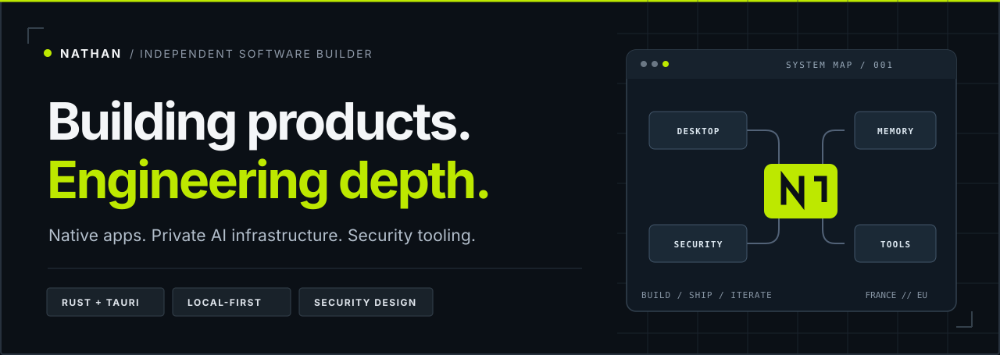
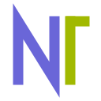

  

  <strong>Independent software builder</strong> · France 
  Desktop products · AI infrastructure · Security engineering · Open source

  <a href="#selected-work">Selected work</a> &nbsp;·&nbsp;
  <a href="#how-i-build">How I build</a> &nbsp;·&nbsp;
  <a href="#toolbox">Toolbox</a> &nbsp;·&nbsp;
  <a href="#connect">Connect</a>

---

## About

I'm **Nathan**, a self-taught developer based in France. I design and build software end to end: product interfaces, native integrations, backend services, storage engines, deployment and release tooling.

My work sits at the intersection of **systems programming, local-first software, applied AI and security research**. I like polished interfaces backed by understandable architecture, and tools that solve real problems rather than just look impressive in a demo.

> Small interfaces. Serious engineering. Software people can own.

## Selected work

### Products & infrastructure

<table>
  <tr>
    <td width="50%" valign="top">
      <h3><a href="https://github.com/VoltLaunchr/Volt">Volt ↗</a></h3>
      
<strong>Everything on your computer. One shortcut.</strong>

      
An open-source, keyboard-first desktop launcher for Windows, macOS and Linux. Search apps and files, run commands, manage clipboard history, notes and extensions — without leaving the keyboard.

      
<code>Rust</code> <code>Tauri 2</code> <code>React</code> <code>TypeScript</code> <code>SQLite</code>

      
<a href="https://voltlaunchr.com">Website</a> · <a href="https://github.com/VoltLaunchr/Volt">Source</a> · <a href="https://github.com/VoltLaunchr/Volt/releases">Releases</a>

    </td>
    <td width="50%" valign="top">
      <h3><a href="https://github.com/BaseMyAI/basemyai">BaseMyAI ↗</a></h3>
      
<strong>Memory that stays with the agent — and with you.</strong>

      
A local-first memory engine for AI agents. Persistent, encrypted and temporal memory with vector and graph retrieval, agent isolation, and interfaces for CLI, MCP and applications.

      
<code>Rust</code> <code>Tokio</code> <code>axum</code> <code>MCP</code> <code>AI</code>

      
<a href="https://basemyai.com">Website</a> · <a href="https://github.com/BaseMyAI/basemyai">Source</a>

    </td>
  </tr>
</table>

### Security engineering & research

| Project | What I'm building | Technologies |
| :--- | :--- | :--- |
| **[Arqenor](https://github.com/Arqenor/arqenor)** | Open-source endpoint detection and response: host telemetry, threat detection, correlation, and investigation across operating systems. | `Rust` `Go` `Sigma` `YARA` |
| **[ScanForge](https://github.com/MikeRoss27/scanforge)** | Scope-aware, artifact-driven recon and security assessment orchestration, with repeatable pipelines and reports. | `Go` `CLI` `Recon` |
| **[RevWeb](https://github.com/MikeRoss27/RevWeb)** | Web application investigation: static inspection, browser analysis and scoped active security probes, with evidence-linked findings. | `Rust` `Web security` |
| **[SupaHunt](https://github.com/MikeRoss27/supahunt)** | Security assessment tooling for Supabase applications, including configuration, exposed interfaces and access-control testing. | `Python` `Supabase` `RLS` |

Security tools are intended for authorized testing and defensive research. Individual repositories document their own scope and safeguards.

### Developer tools & learning

| Project | What it explores | Technologies |
| :--- | :--- | :--- |
| **[PkgSeal](https://github.com/MikeRoss27/pkgseal)** | A trust and provenance layer for choosing Linux packages across different sources. *Early-stage.* | `Rust` `Linux` `Desktop` |
| **[PortSpy](https://github.com/MikeRoss27/portspy)** | A clean terminal view of localhost listeners, their process trees, origins and resource usage. *Pre-release.* | `Rust` `Ratatui` `Windows` |
| **[RustWeek](https://github.com/MikeRoss27/RustWeek)** | Learn Rust through predictions, guided practice and progressively independent exercises. *In development.* | `Rust` `Education` |

## How I build

| Principle | In practice |
| :--- | :--- |
| **Local ownership** | Prefer offline-capable systems, portable data and explicit boundaries around network access. |
| **Engineering clarity** | Design interfaces and architecture together; keep failure modes, permissions and trade-offs visible. |
| **Evidence over hype** | In security and AI, favor reproducible tests and transparent limitations over ambitious claims. |
| **End-to-end thinking** | Care about the complete path from the first interaction to packaging, observability and updates. |

## Toolbox

<table>
  <tr><td><strong>Languages</strong></td><td><code>Rust</code> <code>TypeScript</code> <code>Go</code> <code>Python</code> <code>SQL</code></td></tr>
  <tr><td><strong>Desktop & frontend</strong></td><td><code>Tauri 2</code> <code>React</code> <code>Next.js</code> <code>Tailwind CSS</code></td></tr>
  <tr><td><strong>Backend & storage</strong></td><td><code>Tokio</code> <code>axum</code> <code>Node.js</code> <code>PostgreSQL</code> <code>SQLite</code> <code>SQLCipher</code> <code>Supabase</code></td></tr>
  <tr><td><strong>AI & interfaces</strong></td><td><code>MCP</code> <code>candle</code> <code>Local retrieval</code> <code>Agent systems</code></td></tr>
  <tr><td><strong>Delivery</strong></td><td><code>Docker</code> <code>GitHub Actions</code> <code>Linux</code> <code>Windows</code></td></tr>
</table>

  

## Connect

I enjoy talking about native software, Rust, local AI, developer experience and practical security engineering.

**[GitHub](https://github.com/MikeRoss27)** · **[X / @ShipFastGo](https://x.com/ShipFastGo)** · **[Email](mailto:nathan@voltlaunchr.com)** · **[Volt](https://voltlaunchr.com)** · **[BaseMyAI](https://basemyai.com)**

---

   
  Design it carefully. Build it properly. Keep shipping.

