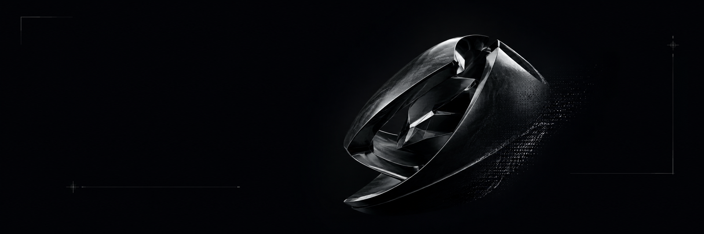

  

  <strong>Independent software builder</strong> · France 
  Desktop software &nbsp; / &nbsp; AI infrastructure &nbsp; / &nbsp; Security engineering

  <a href="#02--featured-work">Featured work</a> &nbsp;·&nbsp;
  <a href="#03--security-tooling">Security tooling</a> &nbsp;·&nbsp;
  <a href="#04--developer-tools">Developer tools</a> &nbsp;·&nbsp;
  <a href="#05--toolbox">Toolbox</a> &nbsp;·&nbsp;
  <a href="#07--connect">Connect</a>

## 01 — About

I'm a **self-taught software developer** building native desktop apps, local AI infrastructure and security tools from France.

I work across the full stack — **product design, Rust systems code, APIs and deployment** — with a focus on performance, privacy and software people can actually own.

**Currently building:** [Volt](https://github.com/VoltLaunchr/Volt) · [BaseMyAI](https://github.com/BaseMyAI/basemyai)

  

## 02 — Featured work

<table>
  <tr>
    <td width="60" align="center" valign="top"></td>
    <td valign="top">
      <strong><a href="https://github.com/VoltLaunchr/Volt">Volt</a></strong> — <em>Everything on your computer. One shortcut.</em> 
      A keyboard-first launcher for Windows, macOS and Linux. Search, commands, clipboard, notes and TypeScript extensions in a native desktop experience. 
      <code>Rust</code> <code>Tauri 2</code> <code>React</code> <code>TypeScript</code> · <a href="https://voltlaunchr.com">Website</a> · <a href="https://github.com/VoltLaunchr/Volt">Source</a>
    </td>
  </tr>
  <tr>
    <td width="60" align="center" valign="top"></td>
    <td valign="top">
      <strong><a href="https://github.com/BaseMyAI/basemyai">BaseMyAI</a></strong> — <em>Private memory infrastructure for AI agents.</em> 
      A local-first memory engine with encrypted persistence, temporal retrieval, agent isolation and Rust-native interfaces including MCP. 
      <code>Rust</code> <code>Tokio</code> <code>axum</code> <code>MCP</code> · <a href="https://basemyai.com">Website</a> · <a href="https://github.com/BaseMyAI/basemyai">Source</a>
    </td>
  </tr>
</table>

## 03 — Security tooling

<table>
  <tr>
    <td width="64" align="center" valign="middle"></td>
    <td valign="top">
      <strong><a href="https://github.com/MikeRoss27/scanforge">ScanForge</a></strong> · <code>Go</code> <code>CLI</code> <code>Recon</code> 
      Scope-aware, artifact-driven orchestration for reconnaissance and authorized security testing. Repeatable pipelines, structured findings and reporting.
    </td>
  </tr>
  <tr>
    <td width="64" align="center" valign="middle"></td>
    <td valign="top">
      <strong><a href="https://github.com/MikeRoss27/RevWeb">RevWeb</a></strong> · <code>Rust</code> <code>Web security</code> 
      Web application assessment through static source inspection, dynamic browser investigation and scoped active probes, with evidence-oriented findings.
    </td>
  </tr>
  <tr>
    <td width="64" align="center" valign="middle"></td>
    <td valign="top">
      <strong><a href="https://github.com/MikeRoss27/supahunt">SupaHunt</a></strong> · <code>Python</code> <code>Supabase</code> <code>RLS</code> 
      Supabase security auditing: application discovery, configuration review and access-control testing within authorized assessments.
    </td>
  </tr>
</table>

Security-related projects are intended for authorized assessments and defensive research.

## 04 — Developer tools

<table>
  <tr>
    <td width="64" align="center" valign="middle"></td>
    <td valign="top">
      <strong><a href="https://github.com/MikeRoss27/pkgseal">PkgSeal</a></strong> · <code>Rust</code> <code>Linux</code> <em>Early stage</em> 
      Compare Linux package sources, inspect provenance and surface transparent trust signals before installation.
    </td>
  </tr>
  <tr>
    <td width="64" align="center" valign="middle"></td>
    <td valign="top">
      <strong><a href="https://github.com/MikeRoss27/portspy">PortSpy</a></strong> · <code>Rust</code> <code>Ratatui</code> <em>Pre-release</em> 
      Understand what's listening on localhost, which process owns the port and which development tool started it.
    </td>
  </tr>
  <tr>
    <td width="64" align="center" valign="middle"></td>
    <td valign="top">
      <strong><a href="https://github.com/MikeRoss27/RustWeek">RustWeek</a></strong> · <code>Rust</code> <code>Learning</code> <em>In development</em> 
      Learn Rust through prediction, guided practice and progressively less scaffolding rather than passive exercises.
    </td>
  </tr>
</table>

## 05 — Toolbox

<table>
  <tr>
    <td align="center" width="54"></td>
    <td><strong>Languages</strong> <code>Rust</code> <code>Go</code> <code>TypeScript</code> <code>Python</code> <code>SQL</code></td>
  </tr>
  <tr>
    <td align="center"></td>
    <td><strong>Desktop &amp; frontend</strong> <code>Tauri 2</code> <code>React</code> <code>Next.js</code> <code>Tailwind CSS</code></td>
  </tr>
  <tr>
    <td align="center"></td>
    <td><strong>Backend &amp; infrastructure</strong> <code>Tokio</code> <code>axum</code> <code>Node.js</code> <code>PostgreSQL</code> <code>SQLite</code> <code>SQLCipher</code> <code>Docker</code> <code>GitHub Actions</code></td>
  </tr>
  <tr>
    <td align="center"></td>
    <td><strong>AI &amp; protocols</strong> <code>candle</code> <code>MCP</code> <code>Local AI</code> <code>Agent memory</code></td>
  </tr>
</table>

## 06 — Engineering approach

**01 / Local-first when it matters**  
Data ownership, offline-capable workflows and encrypted persistence aren't afterthoughts. They're design constraints.  
In practice: [BaseMyAI](https://github.com/BaseMyAI/basemyai) · [Volt](https://github.com/VoltLaunchr/Volt)

**02 / Fast interfaces, native foundations**  
Keyboard-first interaction, predictable behavior and performance you can feel — backed by carefully chosen system-level primitives.  
In practice: [Volt](https://github.com/VoltLaunchr/Volt) · [PortSpy](https://github.com/MikeRoss27/portspy)

**03 / Evidence over black boxes**  
Security findings should be reproducible. Trust decisions should explain themselves. Tools should make their limits visible.  
In practice: [ScanForge](https://github.com/MikeRoss27/scanforge) · [RevWeb](https://github.com/MikeRoss27/RevWeb) · [PkgSeal](https://github.com/MikeRoss27/pkgseal)

## 07 — Connect

  
  
  

  Building ambitious products, one release at a time.

  

